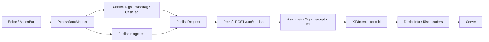

# OKX Orbit — Báo cáo Reverse Engineering và Đối chiếu Codebase

**Ngày lập:** 2026-11-05  
**Target:** OKX Android `okx-6-194-0.apk` — phiên bản 6.194.0 (versionCode 737202)  
**Phạm vi:** quy trình reverse engineering, kiến trúc mạng/ký xác nhận, luồng đăng bài Orbit, đối chiếu với codebase Python hiện tại, đề xuất quy trình tối ưu.  
**Phương pháp:** phân tích tĩnh local (REA + JADX + đọc mã decompile + quét chuỗi native + đối chiếu capture đã có). **Không thực hiện request live nào trong quá trình lập báo cáo.**

> **Chú thích mức độ bằng chứng**
> - **[Observed]** — quan sát trực tiếp từ artifact/mã decompile.
> - **[Derived]** — suy ra từ nhiều quan sát độc lập.
> - **[Inference]** — giả thuyết hợp lý, chưa kiểm chứng runtime.
> - **[Unknown]** — chưa đủ dữ liệu để kết luận.

---

## 0. TL;DR

1. **Lõi ký R1 và `x-id` trong codebase hiện tại vẫn đúng với app 6.194.0.** Công thức `path + body + timestamp`, ECDSA P-256/SHA-256/DER/Base64, public key SPKI DER Base64 và `MD5(devId_path_uuid)` đều khớp.
2. **Khung publish cũng đúng:** endpoint `/priapi/v5/content/ugc/publish`, presign, `publishId` milliseconds, các field bắt buộc `publishId/content/channelId/group`, cách tính `position` 1-based.
3. **Toàn bộ quy trình chưa hoàn hảo.** Có 4 nhóm lỗi P0:
   - Header profile lỗi thời (version 6.166.0, risk fallback sai, `headers-order-string-hash` hardcode, `tmx`/`lua-version` hardcode).
   - `HashTag` thiếu `activityKey` bắt buộc và hardcode `type: 4`.
   - Auto-detect tag bằng regex thay vì dùng danh sách symbol/topic của server; `position` dùng `\b` thay vì `\s`.
   - Metadata ảnh hardcode `1024×1024`; `group`/`channelId` chưa lấy theo account/ngữ cảnh.
4. **Không nên thêm** mã hoá `Encrypt-Strategy: TIME` hoặc combined signing `ok-verify-token`/`ok-verify-sign` nếu chưa xác minh server yêu cầu; Planet mặc định dùng R1 cho POST.
5. **Quy trình tối ưu đề xuất:** versioned profile → header pipeline có trace → DTO builder mô phỏng app → replay/drift test → release runbook theo từng bản APK.

---

## 1. Phạm vi, mục tiêu và ràng buộc an toàn

### 1.1. Mục tiêu

- Hiểu cơ chế ký xác nhận và dựng request của app OKX 6.194.0.
- Xác minh codebase Python hiện tại (tạo từ packet capture) còn đúng hay đã lỗi thời.
- Chỉ ra sai sót có thể gây lỗi 400/401/403 hoặc đăng bài sai metadata.
- Đề xuất quy trình codebase tối ưu, có kiểm chứng và có khả năng cập nhật theo phiên bản app.
- Hỗ trợ phân tích/kiểm thử trong khuôn khổ chương trình bug bounty.

### 1.2. Ràng buộc an toàn

- **Không** sử dụng, đọc thêm, sao chép hoặc exfiltrate cookie/token phiên OKX/Binance trong `okx.txt`, `bi.txt`, `cookies/`.
- Chỉ phân tích local. Mọi kiểm thử live (nếu có) phải nằm trong scope và authorization của chương trình bug bounty.
- Không commit binary, credential, tài liệu provider, `dist/`, `node_modules/` hoặc artifact kế hoạch local (theo `AGENTS.md`).
- Báo cáo chỉ chứa đường dẫn, tên field, công thức và metadata; không chứa giá trị token/cookie thật.

### 1.3. Phân loại kết luận

| Loại | Ý nghĩa |
|---|---|
| Observed | Đọc trực tiếp từ mã decompile/artifact |
| Derived | Suy ra từ chuỗi interceptor + DTO + capture |
| Inference | Giả thuyết về hành vi server, cần test runtime |
| Unknown | Chưa resolve được do thiếu artifact/dữ liệu |

---

## 2. Môi trường và artifact

### 2.1. Công cụ

| Thành phần | Giá trị | Ghi chú |
|---|---|---|
| REA | 6.8.0 | `OKX-APP/rea-main/package.json` |
| Package manager | npm 11.16.0 | `package.json#packageManager` |
| Node pinned | 24.22.1 | `.nvmrc`; shell có thể resolve Node cũ hơn, cần dùng toolchain pinned |
| REA MCP | 234 tools | `work/mcp/tools.json` |
| JADX bridge | v10, engine 0.7.1 | `work/mcp/android-summary.json` |
| JADX decompile | 1.5.x (theo phiên thiết lập) | Dùng cho decompile theo batch |
| Java heap quan sát | 8 GiB | Full-APK load bị OOM; phải decompile theo DEX |

### 2.2. Artifact APK

| Thuộc tính | Giá trị |
|---|---|
| File | `OKX-APP/okx-6-194-0.apk` |
| SHA-256 | `150f7883ea2d1ea762638b6cb5628cf63397d4fe1d756c9a6eb00252bfc90b89` |
| Số DEX | 67 (`work/apk/*.dex`) |
| Native chính | `work/apk/lib/arm64-v8a/libOKCore.so` — 246,773,800 bytes |
| Package (theo inventory) | `com.okinc.okex.gp` |

### 2.3. Cây decompile

| Đường dẫn | Nội dung | Quy mô |
|---|---|---|
| `work/okx-decompiled/sources` | Cây hợp nhất toàn bộ DEX | 263.911 file `.java` |
| `work/okx-src/sources` | Decompile classes25.dex (Orbit/planet) | 45.483 file `.java` |
| `work/jadx-b2` … `work/jadx-b6` | Các batch DEX | Dùng để tra class theo dex gốc |
| `work/OKCore.strings.txt` | Chuỗi từ `libOKCore.so` | 85,7 MB |
| `work/native_priapi.txt` | Chuỗi endpoint native | 117 KB |

### 2.4. Vì sao phải decompile theo DEX

[Observed] REA/JADX load toàn bộ APK với heap 8 GiB bị `java.lang.OutOfMemoryError: Java heap space` (`work/mcp/android-summary.json`).  
[Derived] Giải pháp đã dùng: decompile từng DEX vào các thư mục batch, sau đó hợp nhất thành `work/okx-decompiled/sources`. Cách này giữ được khả năng tra cứu toàn bộ mà không cần tăng heap vượt giới hạn host.

---

## 3. Quy trình reverse engineering đã thực hiện

### 3.1. Bước 1 — Inventory APK

Mục tiêu: xác định phiên bản, số DEX, native lib, package và bề mặt tính năng.

Việc đã làm:
- Kiểm tra tên file/phiên bản APK, SHA-256.
- Đếm 67 DEX, liệt kê native lib.
- Trích manifest components (activity/service/receiver/provider) ra `work/manifest_components.json`.
- Xác định các package quan trọng: `com.okinc.planet` (Orbit), `com.okinc.biz.net.common` (network interceptor), `com.okinc.okrisk` (risk), `com.okinc.planet_api` (API contract).

Kết quả:
- Orbit nằm chủ yếu trong `classes25.dex` → decompile riêng vào `work/okx-src`.
- Native engine `libOKCore.so` chứa endpoint/DTO/signing config liên quan.

### 3.2. Bước 2 — Decompile theo batch

Dạng lệnh đã dùng (ví dụ minh hoạ):

```bash
jadx -d work/jadx-b3 work/apk/classes6.dex
# ... lặp cho các DEX cần thiết
```

Sau đó hợp nhất các cây `sources` vào `work/okx-decompiled/sources`. Với Orbit, ưu tiên `work/okx-src/sources` để tra nhanh.

### 3.3. Bước 3 — Map package và entry point

Các điểm vào đã xác định:

| Mục tiêu | Class/file |
|---|---|
| Retrofit API Orbit | `o.InterfaceC9578PcS` |
| Repository | `o.C9584PcY`, `com.okinc.planet.domain.repository.PlanetRepository` |
| DTO publish | `com.okinc.planet.domain.remote.dto.PublishRequest` |
| DTO tag | `com.okinc.planet.domain.remote.dto.HashTag`, `ContentTags`, `CashTag` |
| Mapper | `com.okinc.planet.domain.remote.mapper.PublishDataMapper` |
| Client builder | `o.C3913EKm` |
| Ký R1 | `com.okinc.biz.net.common.AsymmetricSignInterceptor` |
| X-Id | `com.okinc.biz.net.common.XIDInterceptor` |
| Device headers | `com.okinc.biz.net.common.DeviceInfoInterceptor` |
| Risk session | `com.okinc.okrisk.OKRiskSessionInterceptor` |
| Risk callback | `o.C5840Jei` |
| Encryption | `o.C3952EMe` |
| Topic/hashtag editor | `o.NVK` |
| Format tag | `o.C10267Pvu` |
| Channel enum | `com.okinc.planet_api.publisher.PlanetPublisherChannelId` |
| Build publish request | `o.C9613PdB` |

### 3.4. Bước 4 — Trace network stack

Cách làm:
1. Tìm Retrofit interface của Orbit (`InterfaceC9578PcS`), xác định endpoint publish/presign.
2. Tìm nơi tạo Retrofit/OkHttp (`C3913EKm.initClientBuilder`).
3. Đọc thứ tự `addInterceptor` để xác định interceptor nào chạy trước/sau.
4. Đọc từng interceptor để lấy công thức ký, header và điều kiện áp dụng.

Kết quả: xem mục 4.

### 3.5. Bước 5 — Trace signing

Cách làm:
1. Từ `AsymmetricSignInterceptor`, xác định điều kiện ký và input ký cho GET/POST.
2. Đối chiếu với `crypto_signer.py`.
3. Kiểm tra định dạng public key (`PublicKey.getEncoded()` vs `ecdsa.to_der()`).
4. Kiểm tra `x-id` trong `XIDInterceptor`.
5. Kiểm tra các header được thêm sau ký (`X-Request-Timestamp`, `X-Client-Signature`, `X-Client-Public-Key`).

Kết quả: xem mục 4.2–4.3.

### 3.6. Bước 6 — Trace publish flow

Cách làm:
1. Từ `InterfaceC9578PcS` lấy method publish/presign.
2. Đi ngược lên UI/editor (`NVK`) và mapper (`PublishDataMapper`).
3. Đọc DTO + serializer để xác định field bắt buộc (bitmask).
4. Đọc `C9613PdB` để xác định `publishId`, `group`, `channelId`.
5. Đọc `PublishImageItem` và luồng presign/upload.

Kết quả: xem mục 5.

### 3.7. Bước 7 — Trace tag/position semantics

Cách làm:
1. Đọc `PublishDataMapper` để xem app tạo `HashTag`/`CashTag` từ `ActionBar`.
2. Đọc `NVK.getHyperlinkPositionsForSymbol` để hiểu `position`.
3. Đọc `C10267Pvu` để lấy format tag (`#`, `$`, `@` + space).
4. Đọc `PublisherTopicInfo`/`PlanetPublisherChannelId` để hiểu metadata topic/channel.

Kết quả: xem mục 5.4–5.5.

### 3.8. Bước 8 — Phân tích native

Cách làm:
- Quét chuỗi `libOKCore.so` để tìm endpoint, tên DTO, `SignAlgoKind`, `SecurityConfig`, `EncryptConfig`, `ok-verify-token`, `OKAsymmetricSignEnable`, `appTime`.
- Đối chiếu với Java interceptor để xác định phần nào native thực thi, phần nào Java.

Kết quả:
- Native có hỗ trợ symmetric/K1/R1/combined signing và encryption.
- Java vẫn là nguồn chính cho R1 mặc định của POST.
- Chưa thể chứng minh server bắt buộc combined signing cho publish chỉ bằng phân tích tĩnh.

### 3.9. Bước 9 — Đối chiếu capture và codebase

Cách làm:
- So sánh từng header trong capture với các interceptor đã đọc.
- Phân loại header nào là tĩnh, header nào động theo phiên/thiết bị/thời gian.
- So sánh payload capture với DTO/mapper.
- Ghi nhận khác biệt và mức độ ảnh hưởng.

Kết quả: xem mục 6.

### 3.10. Giới hạn của quy trình

- Không có runtime instrumentation trong báo cáo này.
- Không xác minh được server enforcement cho risk/tmx/combined signing.
- Không resolve được đầy đủ client config `ENe` của Planet (class không có trong cây decompile hiện tại).
- Không đọc/không dùng token thật.

---

## 4. Kiến trúc mạng và ký xác nhận

### 4.1. Chuỗi interceptor

[Observed] `C3913EKm.initClientBuilder` add theo thứ tự:

| Thứ tự | Interceptor | Vai trò |
|---:|---|---|
| 1 | `EMS` | Request tag header |
| 2 | pre-custom interceptors | Hook trước |
| 3 | global interceptors | Hook toàn cục |
| 4 | `C3912EKl` | Xử lý chung |
| 5 | `EMY` | Conditional (theo config) |
| 6 | `C19036eJk` | Header/context |
| 7 | `C3954EMg` | Header/context |
| 8 | `C19040eJo` | Header/context |
| 9 | `OKSignInterceptor` | Legacy/OK sign |
| 10 | `AsymmetricSignInterceptor` | **R1/K1 request signing** |
| 11 | `XIDInterceptor` | **x-id** |
| 12 | `OKDecryptInterceptor` | Decrypt response |
| 13 | network interceptors | Hook network |
| 14 | `C18977eIZ` | Network preprocessing |
| 15 | `EMC` | Network processing |
| 16 | `C19038eJm` | Network processing |
| 17 | post interceptors | Hook sau |

[Observed] Một số subclass bổ sung thêm `DeviceInfoInterceptor`, `EntityInterceptor`, `OKRiskSessionInterceptor`.  
[Unknown] Client config cụ thể của Planet (`ENe`) chưa có trong cây decompile; do đó thứ tự chính xác của các interceptor bổ sung trong client Orbit chưa được xác nhận 100%. Tuy nhiên, các header quan sát trong capture và code interceptor cho phép suy ra phần lớn hành vi.

### 4.2. R1 signing

[Observed] Điều kiện ký trong `AsymmetricSignInterceptor.KWHzl`:

```text
OKAsymmetricSignEnable == "true"
HOẶC (
  requestTag != WEB3
  AND header("OKAsymmetricSignEnable") != "false"
  AND method == "POST"
)
```

[Observed] Input ký:
- GET: `encodedPath + (encodedQuery ?: "") + timestamp`
- POST: `encodedPath + body + timestamp`

[Observed] Signature: `SHA256withECDSA` (P-256), DER, Base64.  
[Observed] Header output:
- `X-Request-Timestamp`: milliseconds
- `X-Client-Signature`: Base64 DER
- `X-Client-Public-Key`: `Base64(PublicKey.getEncoded())` = SPKI DER

[Observed] Public key app dùng `PublicKey.getEncoded()`, tương đương `ecdsa.VerifyingKey.to_der()` của Python (`crypto_signer.py:19`).

**Kết luận:** codebase hiện tại khớp công thức và encoding.

### 4.3. X-Id

[Observed] `XIDInterceptor`:

```text
x-id = MD5(devId + "_" + encodedPath + "_" + UUID.randomUUID())
```

- `encodedPath`: chỉ path, không query.
- MD5 hex lowercase.

Codebase hiện tại dùng cùng công thức (`crypto_signer.py:37-41`). **Khớp.**

### 4.4. Header stack

| Header | Nguồn app | Tính chất | Ghi chú |
|---|---|---|---|
| `User-Agent` | `EMO` | động | Prefix `OKEx-APPEX10754`, version/device/locale theo profile |
| `devId` | `acbm.EZpvd()` | động theo thiết bị | Phải khớp fingerprint |
| `platform` | hardcode `"android"` | tĩnh | |
| `real-app-version` | `uxF.AEQbTJ.OLrzqt()` | động theo app | Không hardcode |
| `x-utc` | `C19045eJt` | động | Offset ISO theo timezone thiết bị |
| `risk-params` | risk callback / fallback | động | Fallback `fp-status=-2` |
| `fingerprint-id` | `acbm.EZpvd()` | động | Fallback = devId |
| `lua-version` | `C3922EKw.getNewProxyInstance()` | động | Không hardcode |
| dynamic map | `C3922EKw.values()` | động | Có thể chứa header bổ sung |
| `app_web_mode` | `C3922EKw.AYXKKw()` | động | `pro`/`lite` theo config |
| `Authorization` | `AuthorizationInterceptor` | động | Token hiện tại |
| `x-simulated-trading` | token type | động | `token.getType().getHeaderValue()` |
| `x-site-info` | `EntityInterceptor` | động | Có thể refresh theo session |
| `tmx-session-id` | risk session | động | Không hardcode |
| `tmx-session-status` | risk session | động | Enum ordinal |
| `headers-order-string-hash` | `OKRiskSessionInterceptor` | động | SHA-256 của tên header |
| `X-FpToken*` | risk callback `C5840Jei` | optional | Chỉ khi có risk token và POST |
| `x-sec-token` | risk callback | whitelist | Chỉ endpoint được whitelist |

[Observed] `C5840Jei` set `risk-params`, `fingerprint-id`, và có thể thêm `X-FpToken`, `X-FpToken-Signature`, `X-FpToken-Timestamp` cho POST khi có risk token.  
[Observed] `OKRiskSessionInterceptor` set `tmx-session-id`/`tmx-session-status`, sau đó tính `headers-order-string-hash`.

### 4.5. `headers-order-string-hash`

[Observed] Công thức:

```python
names = sorted(name.lower() for name in header_names)
hash = sha256("".join(names).encode("utf-8")).hexdigest()
```

- Sort lexicographic, lowercase.
- Join **không separator**.
- SHA-256 hex lowercase.

[Observed] Hash được tính bên trong `OKRiskSessionInterceptor.copydefault`, sau khi đã thêm `tmx-session-*`, trên `request.headers().names()` tại thời điểm đó.  
[Derived] Vì vậy:
- Không được hardcode.
- Không được tính trên toàn bộ header cuối cùng do thư viện HTTP tự thêm (`Host`, `Content-Length`, `Accept-Encoding`…), trừ khi capture chứng minh app tính cả chúng.
- Phải mô phỏng đúng **tầng interceptor** và đúng tập header tại thời điểm hash.

### 4.6. Encryption (optional)

[Observed] `OKEncryptInterceptor` (`C3952EMe`):
- Chỉ chạy khi `Encrypt-Strategy == "TIME"` và method POST.
- Có thể thêm `appTime` vào body nếu header `Encrypt-ignore-extra-body-param != 1`.
- Gọi native `NativeApi.encryptBodyOptimized` và gửi body dạng `{"body":"..."}`.
- Nếu response code `400100`, retry một lần với header `X-Client-Time` (`NativeApi.encryptContent`).

[Derived] Orbit publish mặc định **không** set `Encrypt-Strategy: TIME`, nên không đi vào nhánh mã hoá. Việc thêm mã hoá vào codebase là không cần thiết và có thể làm sai chữ ký/body.

### 4.7. Native combined signing (optional)

[Observed] Native `libOKCore.so` có:
- `SignAlgoKind`: Symmetric, AsymmetricK1, AsymmetricR1, SymmetricAndR1, SymmetricAndK1.
- `SecurityConfig{sign, encrypt}`, `SignConfig{algo, symmetric, asymmetric}`, `EncryptConfig{key, ignore_extra_body_param}`.
- Header `ok-verify-token` / `ok-verify-sign`, R1 headers `x-request-timestamp` / `x-client-signature` / `x-client-public-key`.
- Có thể disable asymmetric bằng `OKAsymmetricSignEnable: "false"`.

[Inference] Các cấu hình này do server/feature bật theo endpoint; không thấy cấu hình SecurityConfig riêng cho `com.okinc.planet` trong phân tích tĩnh. Vì vậy R1 mặc định vẫn là đường chính cho publish, nhưng **chưa thể loại trừ** server thay đổi enforcement trong tương lai.

---

## 5. Luồng đăng bài Orbit trong app

### 5.1. Endpoint

[Observed] `InterfaceC9578PcS`:

| Method | Endpoint | Vai trò |
|---|---|---|
| POST | `/priapi/v5/content/ugc/publish` | Đăng bài |
| POST | `/priapi/v5/content/image/presign` | Lấy presign URL |
| POST | `/priapi/v5/content/ugc/draft` | Lưu draft |
| POST | `/priapi/v5/content/article/publish` | Đăng article |
| POST | `/priapi/v5/content/ugc/articleDraft` | Lưu article draft |
| GET | `/priapi/v5/content/ugc/publishPermission` | Kiểm tra quyền đăng |

### 5.2. Luồng tổng quát



### 5.3. `PublishRequest` — field bắt buộc

[Observed] Bitmask `1289` = các bit 0, 3, 8, 10:

| Field | Bắt buộc | Ghi chú |
|---|---|---|
| `publishId` | Có | milliseconds string |
| `content` | Có | Nội dung cuối cùng |
| `channelId` | Có | Enum channel |
| `group` | Có | Stablecoin của account |
| `imageList` | Không | Default rỗng |
| `pluginList` | Không | Default rỗng |
| `contentTags` | Không | Default rỗng |
| `activityCard` | Không | |
| `channelData` | Không | |
| `scheduledAt` | Không | |
| `contentId` | Không | |
| `draftId` | Không | |
| `quotedContentId` | Không | |

### 5.4. `ContentTags` — mapping chính xác

[Observed] `PublishDataMapper`:

| Loại | Constructor | Field |
|---|---|---|
| Topic (`#`) | `HashTag(tag, activityKey, positions, null, deeplink?, type, null)` | `activityKey = topicId`; `type = hashTagType`; deeplink chỉ khi `type == 4` |
| Link | `HashTag(tag, "", positions, linkUrl, deeplink?, 1, null)` | `type = 1`; `linkUrl` bắt buộc |
| Mention (`@`) | `HashTag(tag, "", positions, null, deeplink, 2, authorId)` | `type = 2`; `authorId` |
| Cash (`$`) | `CashTag(tag, symbol, positions)` | `tag = "$" + symbol + " "` |

[Observed] `HashTag` bitmask `7` → `tag`, `activityKey`, `position` là bắt buộc.  
[Observed] `activityKey` luôn được serialize; topic dùng topicId, link/mention dùng `""`.

### 5.5. `position` — thuật toán

[Observed] `NVK.getHyperlinkPositionsForSymbol`:
- Pattern:
  - Cash: `Pattern.quote("$") + Pattern.quote(symbol) + "\\s"`
  - Topic: `Pattern.quote("#") + Pattern.quote(tag) + "\\s"`
  - Mention: `Pattern.quote("@") + Pattern.quote(name) + "\\s"`
- Tìm tất cả match trong `currentText`.
- Với mỗi `ActionBar` (tag người dùng đã chọn), tìm vị trí match tương ứng và trả về **rank 1-based**.
- Tag chỉ được tạo từ các `ActionBar` đã chọn, không phải mọi chuỗi regex xuất hiện trong content.

[Derived] Vì vậy:
- Phải có whitespace sau tag (`\s`), không phải `\b`.
- Phải dùng đúng symbol/tag string như app.
- Chỉ tag những gì người dùng chọn/topic có trong danh sách server.

### 5.6. Ảnh

[Observed] `PublishImageItem`:
- `url`, `width`, `height`, `fileSize`.
- App lấy width/height thật từ ảnh; `fileSize` từ file.
- Presign body `{requestId}`; upload PUT lên OSS.

[Inference] Nếu presign URL được ký kèm content-type, upload phải gửi đúng content-type. Cần xác minh bằng capture.

### 5.7. `group` và `channelId`

[Observed] `C9613PdB`:
- `group = acaM.OLrzqt.AEQbTJ()` (stablecoin đã lưu của account); nếu null → `""`.
- `channelId` lấy từ `PlanetPublisherChannelId`.
- `PlanetPublisherChannelId.FEED_FOR_YOU = "1001"`; các channel khác (prediction, v.v.) có ID riêng.

[Derived] `1001` chỉ đúng cho For You. Nếu đăng trong ngữ cảnh khác phải đổi channel.

### 5.8. `publishId`

[Observed] `PublishDataMapper.OLrzqt()` = `String.valueOf(System.currentTimeMillis())`.  
[Derived] App dùng millisecond; nên có guard uniqueness và tái sử dụng cùng `publishId` khi retry để tránh đăng trùng.

---

## 6. Đối chiếu với codebase hiện tại

### 6.1. Bảng trạng thái tổng quát

| Thành phần | Trạng thái | Ghi chú |
|---|---|---|
| R1 signature | ✅ Đúng | Công thức, curve, hash, DER, Base64 |
| Public key encoding | ✅ Đúng | SPKI DER Base64 |
| X-Id | ✅ Đúng | MD5(devId_path_uuid) |
| Endpoint publish | ✅ Đúng | `/priapi/v5/content/ugc/publish` |
| Presign | ✅ Đúng | `{requestId}` |
| Required payload | ✅ Đúng | 4 field bắt buộc |
| `publishId` | ✅ Đúng | milliseconds |
| `position` semantics | ⚠️ Đúng hướng, sai chi tiết | `\b` vs `\s`, auto-detect vs selected |
| Header profile | ❌ Lỗi thời | Version, risk, hash, tmx, lua |
| `HashTag` contract | ❌ Thiếu field | `activityKey`, `type` |
| Image metadata | ❌ Hardcode | 1024×1024 |
| `group` / `channelId` | ⚠️ Chưa theo context | USDT/1001 mặc định |
| Retry/idempotency | ⚠️ Chưa rõ | Publish không nên retry mù |

### 6.2. Những phần đã đúng (bằng chứng)

| Nội dung | Codebase | App 6.194.0 |
|---|---|---|
| R1 input POST | `f"{path}{body}{timestamp}"` — `core/crypto_signer.py:45` | `encodedPath + body + timestamp` — `AsymmetricSignInterceptor.java:133` |
| R1 algorithm | ECDSA NIST256p, SHA-256, DER, Base64 — `crypto_signer.py:46-51` | `SHA256withECDSA`, DER, Base64 — `AsymmetricSignInterceptor.java:99-105` |
| Public key | `base64(vk.to_der())` — `crypto_signer.py:19` | `PublicKey.getEncoded()` — `AsymmetricSignInterceptor.java:111` |
| X-Id | `MD5(f"{dev_id}_{path}_{uuid}")` — `crypto_signer.py:40` | `MD5(devId + "_" + encodedPath + "_" + UUID)` — `XIDInterceptor.java:39` |
| Publish endpoint | `publisher.py:153` | `InterfaceC9578PcS.java:81` |
| Presign endpoint | `publisher.py:135` | `InterfaceC9578PcS.java:90` |
| Required fields | `publisher.py:156-160` | `PublishRequest.java:68` |
| `publishId` | `publisher.py:154` | `PublishDataMapper.java:122` |
| Tag format | `publisher.py:94,110` | `C10267Pvu.java:17,22,27` |
| Position 1-based | `publisher.py:96,111` | `NVK.java:880` |

### 6.3. P0 — Lỗi có thể làm request bị đánh dấu/từ chối

#### 6.3.1. Header profile lỗi thời

| Header | Codebase | App 6.194.0 | Hệ quả |
|---|---|---|---|
| `User-Agent` | `6.166.0` — `core/okx_api.py:163` | Version động từ `uxF`; UA dựng từ `EMO` — `DeviceInfoInterceptor.java:29` | Lệch fingerprint app |
| `Real-App-Version` | `6.166.0` — `okx_api.py:166` | `uxF.AEQbTJ.OLrzqt()` — `DeviceInfoInterceptor.java:32` | Lệch version |
| `Risk-Params` | `fp-status=-1` — `okx_api.py:168` | Fallback `fp-status=-2` — `BaseApplication.java:5484` | Risk signal khác |
| `Fingerprint-Id` | `""` — `okx_api.py:169` | Fallback = `devId` — `BaseApplication.java:5484` | Mất liên kết thiết bị |
| `headers-order-string-hash` | Hardcode `574f04...` — `okx_api.py:172` | Tính động SHA-256 — `OKRiskSessionInterceptor.java:29`, `C6054JkN.java:76` | Hash không khớp header set |
| `Tmx-Session-Id` | Hardcode — `okx_api.py:170` | Risk session động — `OKRiskSessionInterceptor.java:24` | Session cũ/hết hạn |
| `Tmx-Session-Status` | Hardcode `3` — `okx_api.py:171` | Enum động — `OKRiskSessionInterceptor.java:24` | Sai trạng thái |
| `Lua-Version` | `6.162.0` — `okx_api.py:173` | `C3922EKw.getNewProxyInstance()` — `DeviceInfoInterceptor.java:35` | Feature gating lệch |
| `X-Utc` | `+07:00` — `okx_api.py:167` | Offset động — `DeviceInfoInterceptor.java:32` | Lệch timezone profile |
| `X-Simulated-Trading` | Hardcode `3` — `okx_api.py:177` | Token type — `AuthorizationInterceptor.java:46-49` | Sai loại tài khoản |

**Cách sửa:** đưa toàn bộ vào profile versioned; tính `headers-order-string-hash` sau khi hoàn tất header set; dùng fallback risk đúng; bỏ hardcode `tmx`, `lua`, `x-utc`.

#### 6.3.2. `HashTag` thiếu `activityKey` và sai `type`

[Observed] `HashTag` yêu cầu `tag`, `activityKey`, `position` (bitmask 7) — `HashTag.java:87-90`.  
[Observed] App luôn truyền `activityKey`: topic = topicId, link/mention = `""` — `PublishDataMapper.java:95,103,110`.  
[Observed] `type` lấy từ `hashTagType` của server; topic thường = 0, topic có deeplink = 4 — `PublishDataMapper.java:95`.

Codebase:
- Auto-detect hashtag không set `activityKey` — `publisher.py:108-113`.
- Hardcode `type: 4` — `publisher.py:112`.

**Hệ quả:** vi phạm contract DTO; hashtag thường bị biến thành activity topic; server có thể trả 400 hoặc render sai.

**Cách sửa:** luôn set `activityKey` (`""` nếu không phải topic); lấy `type` từ topic metadata; chỉ set deeplink khi type 4.

#### 6.3.3. Auto-detect tag bằng regex

[Observed] App chỉ tạo tag từ `ActionBar` người dùng chọn, dùng symbol/topic list của server; pattern yêu cầu `\s` sau tag — `NVK.java:842-851`.

Codebase:
- `$([A-Za-z]{1,10})\b` — `publisher.py:86` → bỏ sót symbol có số (`$1INCH`, `$1000SATS`), có thể tag symbol không tồn tại.
- `#([A-Za-z0-9_]{2,50})\b` — `publisher.py:102` → tag mọi hashtag, kể cả không có trong topic list.
- Dùng `\b` thay vì `\s` → position lệch khi tag ở cuối câu/trước dấu câu.

**Cách sửa:** lấy publisher token/topic list từ server; match exact symbol/tag; tính position bằng pattern `\s`; chỉ tag các mục đã chọn.

#### 6.3.4. `headers-order-string-hash` hardcode

[Observed] Công thức đã xác định; hash phụ thuộc tập header tại thời điểm interceptor chạy.  
[Derived] Hardcode `574f04c12bb202c2ea81827f556f50fe` không thể đúng khi:
- version/UA/risk/tmx/lua thay đổi,
- thêm/bớt `Referer`, `X-Cdn`, `Change`,
- thứ tự/tầng interceptor thay đổi.

**Cách sửa:** tính động; log header set theo stage để đối chiếu capture.

### 6.4. P1 — Sai dữ liệu bài đăng

| Vấn đề | Codebase | App 6.194.0 | Cách sửa |
|---|---|---|---|
| Kích thước ảnh | Hardcode `1024×1024` — `publisher.py:145-146` | Width/height thật của ảnh | Dùng Pillow đọc kích thước |
| `group` | Mặc định `USDT` — `publisher.py:124` | Stablecoin đã lưu của account — `C9613PdB.java:53` | Cấu hình theo account |
| `channelId` | Mặc định `1001` — `publisher.py:124` | Enum theo context — `PlanetPublisherChannelId.java:12` | Lấy theo ngữ cảnh đăng |
| Merge trending tag | Append raw `t_tag` — `publisher.py:180` | Phải qua constructor `HashTag` | Chuẩn hoá `tag`, `position`, `activityKey`, `type` |
| `publishId` collision | Millis — `publisher.py:154` | Millis | Thêm uniqueness guard; reuse khi retry |
| Retry publish | Chưa thấy cơ chế idempotency | App dùng `publishId` | Không retry mù; giữ `publishId` |

### 6.5. P2 — Khả năng mở rộng/độ chính xác

- **Chưa ký GET.** App có nhánh GET (`encodedPath + encodedQuery + timestamp`) — `AsymmetricSignInterceptor.java:118-125`. Publish là POST nên chưa ảnh hưởng, nhưng API đọc khác có thể cần.
- **Header thừa.** `Change`, `X-Cdn`, `Referer` chưa thấy gắn trực tiếp trong các interceptor đã đọc; nếu capture mới không có, nên bỏ để tránh lệch hash/fingerprint.
- **`x-site-info`.** Có refresh trong code — `okx_api.py:145`; cần đảm bảo refresh sau login/session change.
- **Upload OSS.** `Content-Type: None` — `okx_api.py:214`; cần xác minh presign URL có ký content-type hay không.

### 6.6. Những thứ không nên thêm

- **Không thêm `Encrypt-Strategy: TIME`** nếu không cần. App chỉ mã hoá khi request có header này; Planet publish không set.
- **Không thêm `ok-verify-token`/`ok-verify-sign`** theo kiểu "cho chắc". Đây là combined signing do SecurityConfig của endpoint bật; thêm sai có thể làm hỏng request.
- **Không bịa giá trị risk SDK** (`tmx`, `fp-token`). Nếu không tái tạo được SDK, dùng fallback đúng như app.

### 6.7. Những điểm chưa thể kết luận

- [Unknown] Server có bắt buộc risk token/tmx cho publish hay không.
- [Unknown] Client config `ENe` của Planet có gắn `OKRiskSessionInterceptor`/`DeviceInfoInterceptor`/`EntityInterceptor` theo thứ tự nào.
- [Unknown] Giá trị `lua-version` chính xác của 6.194.0 (cần đọc từ asset/config của APK).
- [Unknown] Presign URL có ký content-type hay không.
- [Unknown] `group` mặc định của từng account (USDT/USDC/khác).

---

## 7. Quy trình tối ưu codebase

### 7.1. Kiến trúc mục tiêu

```text
core/
  crypto/          # R1 signer, x-id, key store (pure)
  transport/       # session, HTTP, retry, idempotency, rate limit
  profile/         # app/device/header profile theo version
  dto/             # mirror DTO của app
  orbit/           # publish, presign, upload, interact
profiles/
  okx_6.194.0.json
tests/
  fixtures/        # capture đã sanitize
  replay/          # replay compare
tools/
  capture_sanitize.py
  drift_check.py
```

Mục tiêu:
- Không còn literal version/header rải rác.
- Mỗi layer có trách nhiệm rõ ràng.
- Có thể cập nhật theo APK mới mà không sửa logic ký.

### 7.2. Versioned profile

Ví dụ `profiles/okx_6.194.0.json` (placeholder, không chứa secret):

```json
{
  "app": {
    "version": "6.194.0",
    "real_app_version": "6.194.0",
    "user_agent_template": "OKEx-APPEX10754/{version} ({model}; U; Android {android}; {locale};) locale={locale}",
    "lua_version": "<lay-tu-apk>",
    "app_web_mode": "pro"
  },
  "device": {
    "model": "<device-model>",
    "android": "<android-version>",
    "locale": "vi-VN",
    "timezone": "<auto>"
  },
  "risk": {
    "fallback_risk_params": "fp-status=-2",
    "fallback_fingerprint_id": "<devId>"
  },
  "orbit": {
    "default_channel_id": "1001",
    "default_group": "<account-stablecoin>"
  }
}
```

Nguyên tắc:
- `version`, `lua_version`, `app_web_mode` phải lấy từ APK/config, không đoán.
- `devId`, key, token lưu ngoài profile (data/keys, session store).
- Profile là dữ liệu versioned; có test đọc profile.

### 7.3. Header pipeline có trace

Pseudo-code:

```python
class HeaderPipeline:
    def build(self, req, profile, session, signer):
        ctx = HeaderContext()
        self.add_base(ctx, req, profile)
        self.add_device(ctx, profile, session)
        self.add_auth(ctx, session)
        self.add_xid(ctx, req, session)
        self.add_signature(ctx, req, signer)
        self.add_risk_session(ctx, session)
        self.add_order_hash(ctx)     # luôn cuối
        return ctx.headers
```

Quy tắc:
- Mỗi stage gắn tag `stage` để debug.
- `add_order_hash` tính trên đúng tập tên header tại thời điểm đó.
- Không để thư viện HTTP tự thêm header vào hash.
- Có `debug_trace=True` để so sánh với capture app.

### 7.4. Signer abstraction

```python
class SignStrategy(Protocol):
    def sign(self, path: str, query: str, body: bytes, timestamp_ms: int) -> dict[str, str]:
        ...
```

Triển khai:
- `R1SignStrategy` (mặc định, đã đúng).
- `K1SignStrategy` (nếu cần).
- `SymmetricStrategy` / `CombinedStrategy` (chỉ bật khi có SecurityConfig từ server).

Điều kiện:
- Body ký phải là **đúng bytes** sẽ gửi.
- Không serialize lại body sau khi ký.
- Timestamp dùng cùng giá trị cho input ký và header.
- GET dùng `encodedPath + encodedQuery`.

### 7.5. DTO builder

```python
class PublishRequestBuilder:
    def build(self, content, images, channel, group, selected_tags):
        publish_id = new_publish_id()
        tags = self.resolve_tags(content, selected_tags)
        return {
            "publishId": publish_id,
            "content": content,
            "channelId": channel,
            "group": group,
            "imageList": [self.image_item(i) for i in images],
            **({"contentTags": tags} if tags.has_any else {}),
        }
```

`resolve_tags`:
- Nhận danh sách topic/token từ server.
- Match exact symbol/tag trong content bằng pattern `\s`.
- Topic: `activityKey = topicId`, `type = hashTagType`, deeplink nếu 4.
- Link: `type = 1`, `linkUrl`.
- Mention: `type = 2`, `authorId`.
- Cash: `tag = "$SYMBOL "`, `coinName = symbol`.
- Không append raw dict từ trending list; chuẩn hoá qua constructor.

### 7.6. Test và kiểm chứng

#### Fixture/replay

- Lưu capture đã sanitize: header set + body + timestamp + path.
- Replay qua mock server; so sánh:
  - header app-level,
  - JSON semantic diff,
  - hash tính lại,
  - signature verify bằng public key.
- Không lưu token/cookie thật.

#### Golden cases

- Bài không ảnh.
- Bài có ảnh (nhiều kích thước).
- Bài có `$BTC`, `$1INCH`.
- Bài có `#topic` type 0 và type 4.
- Tag lặp nhiều lần.
- Unicode/emoji.
- Tag ở cuối câu/trước dấu câu.
- Trending tag không có `position`.

#### Drift check

Khi có APK mới:
1. Decompile bằng REA/JADX.
2. Diff:
   - `PublishDataMapper`, `HashTag`, `PublishRequest`, `ContentTags`.
   - `AsymmetricSignInterceptor`, `XIDInterceptor`, `DeviceInfoInterceptor`, `OKRiskSessionInterceptor`.
   - `PlanetPublisherChannelId`.
   - `InterfaceC9578PcS` endpoints.
3. Cập nhật profile + fixtures.
4. Chạy replay; chỉ release khi diff được giải thích.

### 7.7. Release runbook theo APK mới

1. Pin version + SHA-256 APK.
2. Inventory DEX/native.
3. Decompile batch; cập nhật cây sources.
4. Chạy drift check.
5. Cập nhật profile (version/UA/lua/app_web_mode/risk fallback).
6. Chạy replay + golden tests.
7. Smoke test trong scope bug bounty với test account.
8. Ghi changelog: field/endpoint/header thay đổi.

### 7.8. Vệ sinh bảo mật

- `.gitignore`: `data/keys/`, `cookies/`, `okx.txt`, `bi.txt`, `captures/`, `*.pem`.
- Sanitizer xoá `Authorization`, `x-id`, signature, `tmx-*`, `fp-*` trước khi lưu fixture.
- Log không in full header/body.
- Không gửi capture/token ra dịch vụ thứ ba.
- Chỉ test live trong phạm vi chương trình bug bounty.

### 7.9. Lộ trình triển khai

| Phase | Nội dung | Tiêu chí hoàn thành |
|---|---|---|
| 0 | Tạo profile + HeaderPipeline + trace | Không còn hardcode version/header động |
| 1 | Sửa `HashTag`/`ContentTags` builder | Không còn missing `activityKey`, sai `type` |
| 2 | Sửa image/group/channel | Payload khớp app cho 5 golden cases |
| 3 | Replay + drift check | Diff header/body được giải thích tự động |
| 4 | Runtime smoke test trong scope | Xác nhận server chấp nhận request |

---

## 8. Checklist xác minh

### 8.1. Checklist P0

- [ ] `HashTag.activityKey` luôn có (topicId hoặc `""`).
- [ ] `HashTag.type` lấy từ `hashTagType`, không hardcode 4.
- [ ] Không auto-tag mọi regex; chỉ tag symbol/topic có trong danh sách server.
- [ ] Pattern position dùng `\s`, exact case, đúng symbol/tag.
- [ ] `User-Agent`/`Real-App-Version` theo 6.194.0.
- [ ] `risk-params` fallback `fp-status=-2`.
- [ ] `fingerprint-id` = devId.
- [ ] `headers-order-string-hash` tính động, đúng stage.
- [ ] Bỏ hardcode `tmx-session-id/status`, `lua-version`, `x-utc`.
- [ ] `x-simulated-trading` khớp token type.

### 8.2. Checklist P1

- [ ] Width/height ảnh lấy thật.
- [ ] `group` lấy theo stablecoin của account.
- [ ] `channelId` theo context.
- [ ] Trending tag được chuẩn hoá qua builder.
- [ ] `publishId` uniqueness + idempotent retry.
- [ ] Presign/upload content-type được xác minh.

### 8.3. Kiểm chứng runtime (trong scope)

- [ ] So sánh response publish giữa app và client với cùng nội dung.
- [ ] Kiểm tra server có challenge risk/tmx không.
- [ ] Kiểm tra `group`/`channelId` nào được chấp nhận.
- [ ] Kiểm tra upload ảnh với content-type khác nhau.
- [ ] Không retry mù POST publish; giữ `publishId`.

### 8.4. Điều không làm

- [ ] Không dùng token/cookie thật ngoài scope.
- [ ] Không commit capture chứa secret.
- [ ] Không thêm encryption/combined signing khi chưa xác minh.
- [ ] Không hardcode giá trị risk SDK.

---

## 9. Rủi ro và điểm chưa xác minh

| Điểm | Mức độ | Tác động | Hướng xử lý |
|---|---|---|---|
| Server enforcement risk/tmx | Trung bình | Request có thể bị challenge dù chữ ký đúng | Test runtime trong scope; so sánh app |
| Client config `ENe` chưa resolve | Thấp–Trung bình | Không biết chính xác interceptor nào chạy | Decompile thêm DEX chứa `ENe`; trace `C9532PbY` |
| `lua-version` chưa xác định | Thấp | Feature gating/fingerprint lệch | Đọc asset/config APK |
| OSS content-type | Thấp | Upload 403 | Thử capture/presign response |
| `group` theo account | Trung bình | Bài đăng sai nhóm | Lấy stablecoin từ session/config |
| Native validator/deeplink chưa RE | Thấp | Bỏ sót cơ chế deeplink | Phân tích native sâu hơn nếu cần |
| Chưa test live | Cao (về độ tin cậy) | Kết luận mới ở mức tĩnh | Chạy smoke test trong scope |

---

## 10. Phụ lục

### 10.1. Bảng bằng chứng chính

| Chủ đề | File | Dòng |
|---|---|---|
| R1 condition | `work/jadx-b3/sources/com/okinc/biz/net/common/AsymmetricSignInterceptor.java` | 197-211 |
| R1 POST input | cùng file | 127-133 |
| R1 GET input | cùng file | 118-125 |
| R1 signature/header | cùng file | 99-111 |
| X-Id | `work/jadx-b3/sources/com/okinc/biz/net/common/XIDInterceptor.java` | 32-39 |
| Device headers | `work/jadx-b3/sources/com/okinc/biz/net/common/DeviceInfoInterceptor.java` | 29-49 |
| Risk fallback | `work/jadx-b3/sources/com/okinc/common/application/BaseApplication.java` | 5484 |
| Risk session | `work/okx-src/sources/com/okinc/okrisk/OKRiskSessionInterceptor.java` | 20-30 |
| Hash algorithm | `work/okx-src/sources/o/C6054JkN.java` | 76-90 |
| Risk callback | `work/okx-src/sources/o/C5840Jei.java` | 59-101 |
| Encryption | `work/jadx-b3/sources/o/C3952EMe.java` | 47, 52, 99-128, 156 |
| Client chain | `work/jadx-b3/sources/o/C3913EKm.java` | 118-149 |
| Publish endpoint | `work/okx-src/sources/o/InterfaceC9578PcS.java` | 81, 90 |
| Publish DTO | `work/okx-src/sources/com/okinc/planet/domain/remote/dto/PublishRequest.java` | 68, 112-136 |
| HashTag DTO | `work/okx-src/sources/com/okinc/planet/domain/remote/dto/HashTag.java` | 31-37, 87-90, 116-134 |
| Mapper | `work/okx-src/sources/com/okinc/planet/domain/remote/mapper/PublishDataMapper.java` | 86-122 |
| Tag format | `work/okx-src/sources/o/C10267Pvu.java` | 15-28 |
| Position | `work/okx-decompiled/sources/o/NVK.java` | 833-883 |
| Channel enum | `work/okx-src/sources/com/okinc/planet_api/publisher/PlanetPublisherChannelId.java` | 12 |
| Build request | `work/okx-src/sources/o/C9613PdB.java` | 39-57 |
| User R1 | `core/crypto_signer.py` | 43-51 |
| User X-Id | `core/crypto_signer.py` | 37-41 |
| User public key | `core/crypto_signer.py` | 19 |
| User headers | `core/okx_api.py` | 156-191 |
| User publish | `core/publisher.py` | 59-122, 124-160, 163-183 |

### 10.2. Thuật ngữ

| Thuật ngữ | Nghĩa |
|---|---|
| R1 | ECDSA P-256 + SHA-256, DER, Base64 |
| K1 | ECDSA secp256k1 |
| `x-id` | MD5(devId_path_uuid) |
| `publishId` | ID bài đăng, milliseconds |
| `activityKey` | Topic ID cho hashtag topic; `""` cho tag thường |
| `hashTagType` | 0 topic thường, 4 topic có deeplink |
| `position` | Rank 1-based của lần xuất hiện tag |
| `group` | Stablecoin của account (USDT/USDC/…) |
| `channelId` | ID channel đăng bài (1001 = For You) |

### 10.3. Lịch sử báo cáo

| Ngày | Nội dung |
|---|---|
| 2026-11-05 | Bản đầu tiên: reverse 6.194.0, đối chiếu codebase, đề xuất quy trình tối ưu |
